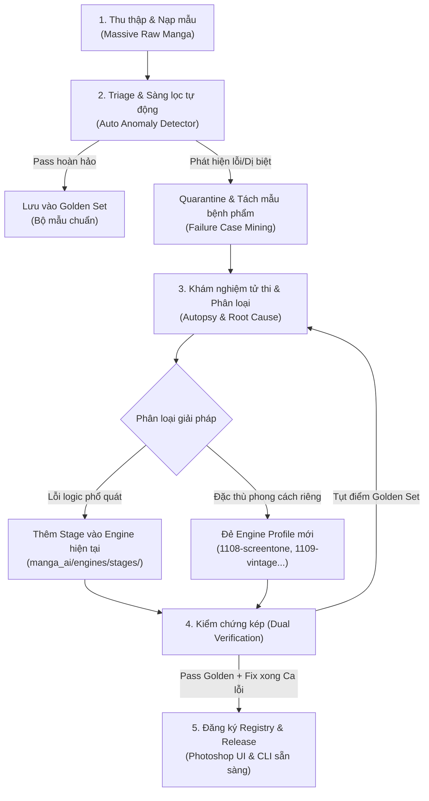

# Quy trình Chuẩn hóa Tiến hóa Engine (CEEP Framework)

Tài liệu này chuẩn hóa quy trình **thu thập dữ liệu lớn (Massive Samples) $\rightarrow$ Khám nghiệm lỗi $\rightarrow$ Phát triển Heuristic/Stage mới $\rightarrow$ Chốt chặn hồi quy (Regression Gate)** để mở rộng hệ sinh thái Engine cho Manga Typesetter AI một cách khoa học, có thể lặp lại và không sợ vỡ hệ thống cũ.

---

## 1. Vòng tuần hoàn Tiến hóa Engine (Core Loop)



---

## 2. Chuẩn hóa Cấu trúc Dữ liệu Mẫu (`evaluation/`)

Để quản lý hàng trăm đến hàng ngàn trang manga từ nhiều tác giả mà không bị lẫn lộn:

```
evaluation/
├── golden_set/                     # Bộ 30-50 trang chuẩn không bao giờ được phép chạy sai
│   ├── modern_shonen_01.png
│   ├── seinen_dense_02.png
│   └── manifests/                  # Ground truth & kết quả baseline được duyệt
├── incoming_batches/               # Nơi chứa các chapter/bộ truyện mới nạp vào
│   ├── style_vintage_scan/
│   ├── style_screentone_heavy/
│   └── style_shoujo_borderless/
├── failure_cases/                  # Các trang bị thuật toán "bắt hụt" hoặc "ăn nhầm"
│   ├── FC_001_ink_bleed/           # Từng ca bệnh có thư mục riêng
│   │   ├── original.png
│   │   ├── trace.json              # Trace quyết định của engine
│   │   ├── diff_mask.png           # So sánh vùng lỗi
│   │   └── bug_report.md           # Mô tả ngắn: "Lẹm tóc / Chữ mờ chưa hết"
│   └── FC_002_borderless_bubble/
└── regression_reports/             # Báo cáo điểm số tự động sau mỗi lần sửa code
```

---

## 3. Quy trình 5 bước tác chiến chi tiết

### Bước 1: Nạp hàng loạt & Quét phát hiện dị thường (Batch Triage)
Không cần tự soi mắt từng trang trong hàng trăm trang truyện. Sử dụng cơ chế sàng lọc dựa trên chỉ số bất thường:
* **Residual Ink Metric:** Kiểm tra sau khi clean, trong vùng nội tiếp bóng thoại còn lại bao nhiêu pixel đen mồ côi (chữ chưa tẩy sạch).
* **Boundary Infringement:** Mặt nạ clean có đâm xuyên qua đường viền nét đen chính của khung tranh hay không.
* **Head/Face Intrusion:** Mặt nạ clean có vô tình phủ đè lên bounding box của `animeheadsv3` hay không.
* **Tỷ lệ Review Required:** Nếu một trang có số lượng vùng "Cần can thiệp thủ công" > 60%, trang đó tự động được gắn cờ đẩy vào `failure_cases/`.

---

### Bước 2: Khám nghiệm tử thi (Failure Diagnostics)
Mỗi mẫu bệnh phẩm được đưa vào bàn mổ với **Ma trận chẩn đoán 4 tầng**:

| Tầng lỗi | Triệu chứng thực tế | Nguyên nhân kỹ thuật | Hướng khắc phục |
| :--- | :--- | :--- | :--- |
| **Tầng 1: Proposal (Bỏ sót)** | Chữ hét/lời dẫn ô vuông không hề có bounding box | YOLO/CTD bị tụt confidence dưới threshold | Bổ sung fallback detector hoặc hạ ngưỡng có kiểm soát kèm OCR verification |
| **Tầng 2: Boundary (Xâm phạm)** | Mask clean ăn cụt lọn tóc, lẹm vào viền áo | Mask loang quá đà do gradient viền mờ hoặc nét đứt | Thuật toán chặn biên tích cực (Active Contour / Gradient Stopping) |
| **Tầng 3: Ownership (Tranh chấp)** | Hai bóng thoại dính nhau bị nhập thành 1, hoặc chữ bóng này gán sang bóng kia | Polygon Voronoi chia sai tâm khối | Tách component phân đoạn (Connected Components) dựa trên mật độ chữ |
| **Tầng 4: Finish (Tô nền hỏng)** | Vệt chữ xám mờ còn sót lại, hoặc làm bẹt dí vùng chấm trame | Màu donor lấy sai hoặc trường nền phẳng không hợp với nền hạt | Chuyển đổi bộ tạo nền (Flat field $\rightarrow$ Texture patch / Screentone synth) |

---

### Bước 3: Đưa ra Quyết định Kiến trúc: Nâng cấp Stage hay Đẻ Profile mới?

* **Nếu là lỗi tư duy thuật toán chung** (ví dụ: giải thuật tìm tâm bóng thoại bị lệch khi gặp khung tranh hẹp) $\rightarrow$ Sửa trực tiếp vào `manga_ai/engines/stages/`.
* **Nếu là đặc thù phong cách nghệ thuật** (ví dụ: truyện thể loại kinh dị toàn nét xước, truyện in giấy báo cũ có hạt tram to) $\rightarrow$ Khởi tạo file engine mới kế thừa hợp đồng `EngineContract` (`manga_ai/engines/contracts.py`) để không làm ảnh hưởng engine 1107 hiện tại.
  * `1107-flat-paper`: Manga hiện đại, digital, giấy trắng.
  * `1108-screentone`: Manga dùng trame hạt, bảo vệ kết cấu nền chấm.
  * `1109-vintage`: Scan cũ, truyện tranh scan giấy vàng, khử lem mặt sau.
  * `1110-freeform`: Bóng thoại không viền, gradient nghệ thuật.

---

### Bước 4: Kiểm chứng Hồi quy Kép (Dual Regression Gate)

Bất kỳ thay đổi code nào cũng phải vượt qua bài kiểm tra kép trước khi được chấp nhận:
1. **Gate 1 - Golden Set Non-Regression:** Chạy lại toàn bộ bộ mẫu chuẩn (`evaluation/golden_set`). Độ chính xác trên các ca cũ không được giảm dù chỉ 1 pixel viền.
2. **Gate 2 - Target Sample Resolution:** Các ca trong `failure_cases` của đợt này được giải quyết sạch sẽ; trace quyết định (`trace.json`) ghi nhận lý do rõ ràng, không dùng hardcoded bounding box.

---

### Bước 5: Đóng gói Version & Cập nhật Photoshop UI

Khi một đợt cải tiến hoàn tất:
1. Engine mới được đăng ký trong `manga_ai/engines/__init__.py` với mã version định danh (ví dụ `1107-shadow-0.5` hoặc `1108-screentone-0.1`).
2. Giao diện Photoshop (`Photoshop_Typeset.jsx`) tự động nạp engine mới vào dropdown ở Tab *2. Engine clean* mà không cần viết lại giao diện JSX.
3. Sinh báo cáo kiểm chứng kỹ thuật trong `docs/validation/`.
